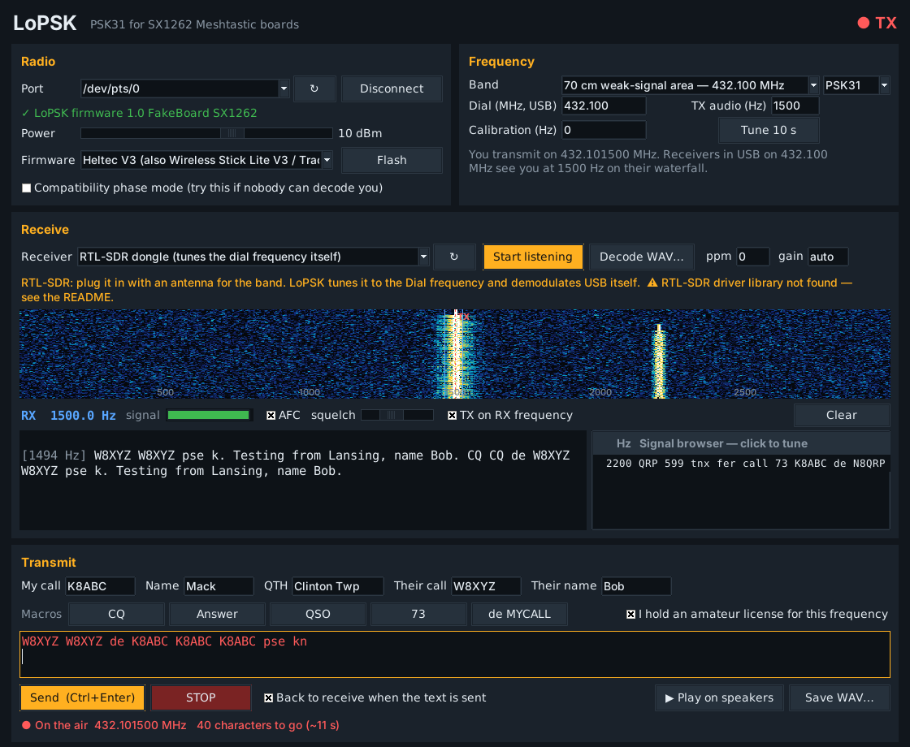

# LoPSK — PSK31 from your Meshtastic LoRa board

LoPSK turns an SX1262-based Meshtastic board (Heltec V3, T-Beam SX1262, T3-S3) into a real **PSK31 / PSK63 transmitter**, and gives you a full **PSK31 decoder** with a waterfall, click-to-tune, AFC and a signal browser that reads every PSK signal in the passband at once.

Anyone running fldigi (or any PSK31 program) on a receiver tuned to your frequency in USB mode will read you like any other PSK31 station.

## How a LoRa chip sends PSK

PSK31 sends a **0** by flipping the carrier's phase 180° and a **1** by leaving it alone. The SX1262 has no phase control — but its synthesizer moves in 0.95 Hz steps without breaking phase. Running a little high for a moment *adds* phase, so a smooth, 16 ms nudge that adds exactly half a cycle **is** a 180° reversal. The firmware does this every 1 ms tick, rounding to whole synthesizer steps and carrying the error forward, so each reversal lands within 0.001 cycle. Reversals alternate up/down so the signal stays symmetric and narrow, like normal PSK31.

The difference from a textbook transmitter: the amplitude stays constant (no dip to zero between symbols). PSK31 receivers only look at the phase, so this doesn't matter to them.

## What it can and can't do

- **Transmit:** PSK31 or PSK63, typed text, macros (CQ, Answer, QSO, 73), live keyboard mode (press Enter while on the air to send each line).
- **Receive:** with an **RTL-SDR** dongle (LoPSK tunes it and demodulates USB itself), any **sound card** input (a radio in USB, or SDR++ / SDR# through a virtual audio cable), or a **WAV recording**.
- **The LoRa board can't decode PSK.** Its narrowest filter is ~4.8 kHz wide and it gives no phase information. LoPSK can still use it as a **signal-strength meter** on your frequency.
- **SX1262 boards only.** Older SX1276/SX1278 boards step in 61 Hz, far too coarse.
- **Bands:** the chip covers 150–960 MHz, so 70 cm (420–450 MHz) and 33 cm (902–928 MHz). There's no established PSK31 calling frequency up there — the presets (432.100 MHz in the 70 cm weak-signal area, 903.100 MHz) are suggestions. Agree a frequency with whoever is listening.
- **Antenna:** a 915 MHz-version board will still transmit on 432 MHz, but its filter and antenna aren't tuned for it, so expect much less output. A 433 MHz-version board with a 70 cm antenna works best.
- **License:** you need an amateur license for the band. Your macros send your callsign, which identifies you.
- Flashing LoPSK replaces Meshtastic (or LoFT8) on that board. Put Meshtastic back anytime at flasher.meshtastic.org.

## Setup

**Windows:** install Python 3 from python.org (tick "Add to PATH"), then double-click `app/Run LoPSK (Windows).bat`. It installs pyserial, esptool, numpy and sounddevice the first time. For an RTL-SDR, run Zadig once, pick "Bulk-In, Interface (Interface 0)" and install WinUSB.

**Raspberry Pi:** `bash app/install-pi.sh`, then open LoPSK from the menu (Internet / Ham Radio) or the Desktop. Log out and back in once so the USB port permission takes effect.

Then:
1. Plug in the board, pick its port, choose your board under **Firmware** and click **Flash** (hold BOOT while plugging in if it won't start).
2. Click **Connect**. You should see `✓ LoPSK firmware 1.0 … SX1262`.
3. Enter your call, name and QTH, tick the license box.

## Using it

**Receive:** pick a receiver and press **Start listening**. Click any trace on the waterfall to read it — the blue lines show where you're tuned, AFC follows the station, and the green bar shows signal quality. The **signal browser** on the right decodes every other PSK signal it finds at the same time; click a line to switch to it. Your own callsign is highlighted in red.

**Transmit:** type in the bottom box or click a macro, then **Send** (Ctrl+Enter). With **TX on RX frequency** ticked, you answer exactly where the station you're reading is. The red dashed line on the waterfall is your TX frequency (right-click the waterfall to move it on its own). Sent text is echoed in red. Untick **Back to receive when the text is sent** to stay on the air and type line by line.

**Calibration:** press **Tune 10 s** and look at where the steady carrier lands on a receiver tuned to the dial frequency. If it should be at 1000 Hz but shows at 1012 Hz, set Calibration to −12. (PSK31 receivers have AFC, so being a few Hz off is fine.)

**Play on speakers / Save WAV:** hear, or save, exactly what the board will send — computed tick-for-tick the same way the firmware does it. Open the WAV in fldigi or with Decode WAV to check it.

**Compatibility phase mode:** if receivers see your carrier but can't decode you, tick this. It re-keys the carrier on every nudge, the way LoFT8 changes tones, in case a particular chip ignores frequency changes while transmitting.

## How it was tested

- The Varicode table matches fldigi's table entry-for-entry.
- The **actual firmware code** was compiled and run on a PC against a simulated radio; its frequency log was turned back into audio and decoded **100%** by csdr (the PSK31 decoder used by OpenWebRX, which shares no code with LoPSK) down to −9 dB SNR in 2.5 kHz, and by LoPSK's own decoder.
- LoPSK's decoder: 97% character copy at −9 dB SNR on textbook PSK31 and 94% on the board's signal (PSK31 usually stops copying around −10 dB).
- The full app was driven end-to-end against a pretend board: the bits the "board" sent decoded back to exactly the typed text, while two simulated stations were decoded on the waterfall and in the signal browser.
- Firmware compiles for all three boards. **Not yet tested on a physical board** — your first transmission is the real test.

Tests are in `tests/`: `test_loop.py` (encode → noise → decode), `test_firmware.py` + `tests/host/` (runs the real firmware on a PC), `test_app.py` + `fake_board.py` (whole app).

## Files

- `app/` — the desktop app (`lopsk_app.py`), PSK31 encoder (`psk31.py`), decoder (`psk31rx.py`), receivers (`rx_sources.py`), and ready-to-flash firmware images.
- `firmware/` — Arduino source. Rebuild with `firmware/build.sh` (arduino-cli + ESP32 core 3.3.x), or open `LoPSK/LoPSK.ino` in the Arduino IDE and uncomment your board at the top of `board.h`.

## Serial protocol (for tinkering)

115200 baud, one command per line: `HELLO`, `PWR <dBm>`, `STEER <0|1>`, `PSK <hz> <baud>`, `B <bits>`, `END`, `TUNE <hz> <seconds>`, `LISTEN <hz>` (streams `R <dBm×10>` 50×/s), `STOP`, `STATUS`. While transmitting the board reports `Q <queued bits>` 4×/s. It drops the carrier after 60 s of idle, or if the app goes quiet for 10 s.

## Credits

PSK31 and Varicode by Peter Martinez, G3PLX. Radio driver: RadioLib (MIT). T-Beam power management: XPowersLib (MIT). Sister project: [LoFT8](https://github.com/hardwaremack-prog/loft8) (FT8 from the same boards).
